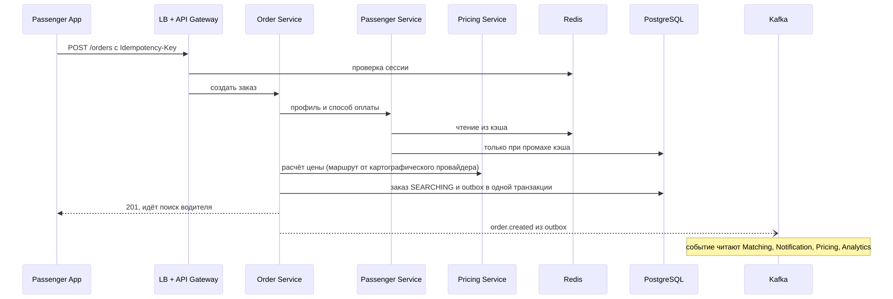
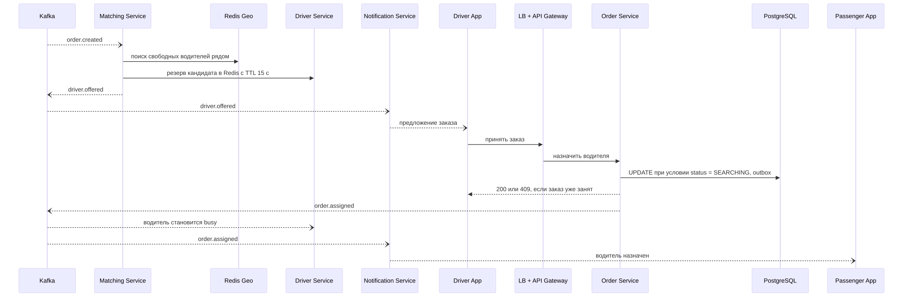
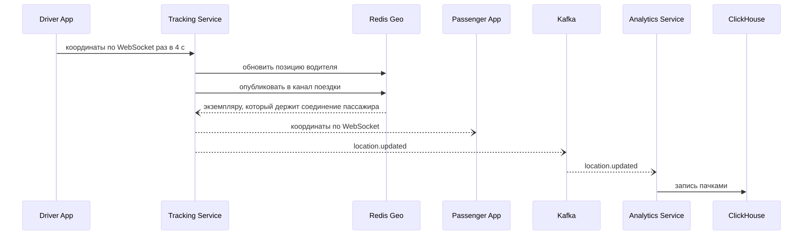
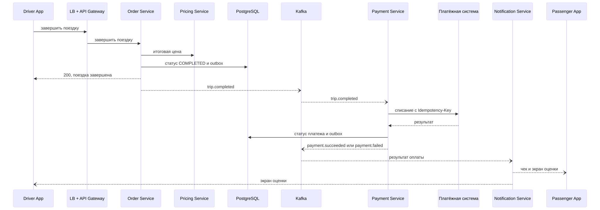
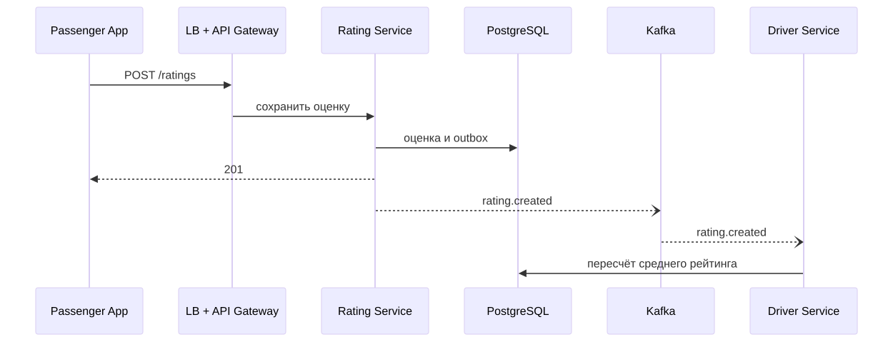

# ДЗ 1. Анализ референсной архитектуры: сервис такси

## 0. Контекст системы

Сервис такси (Uber, Яндекс Go) — ride-sharing платформа, которая соединяет пассажиров и водителей.
Пассажир заказывает поездку с телефона, а система подбирает ближайшего свободного водителя, считает цену и проводит оплату.

**Акторы**

- Пассажир — заказывает поездку, следит за машиной, платит и ставит оценку.
- Водитель — выходит на линию, принимает заказы, выполняет поездки.
- Менеджер — настраивает тарифы, смотрит отчёты и аналитику.

**Ключевые сценарии**

1. Пассажир создаёт заказ и видит цену.
2. Система подбирает водителя, водитель принимает заказ.
3. Пассажир видит движение машины в реальном времени.
4. Водитель завершает поездку, система списывает оплату.
5. Пассажир и водитель ставят друг другу оценки.

**Масштаб (грубая оценка)**

Исходные данные: 6 млн водителей, из них 3 млн активных, 20 млн пассажиров, 10 млн поездок в сутки.
Допущения: пиковая нагрузка в 4 раза выше средней, в пик на линии 1 млн водителей, водитель отправляет координаты раз в 4 секунды, на одну поездку приходится около 20 API-запросов, поездка длится в среднем 20 минут.

| Показатель | Расчёт | Порядок |
| --- | --- | --- |
| Создание заказов | 10 млн / 86 400 с ≈ 116 RPS, в пик × 4 | ~500 RPS |
| Все API-запросы | 200 млн в сутки ≈ 2 300 RPS, в пик × 4 | ~10 000 RPS |
| Обновления координат | 1 млн водителей / 4 с | ~250 000 в секунду |
| WebSocket-соединения в пик | 1 млн водителей + ~0,5 млн пассажиров в поездке | ~1,5 млн |
| Заказы, платежи, оценки | 10 млн × ~5 КБ | ~50 ГБ в сутки, ~18 ТБ в год |
| История координат | ~125 000 в секунду в среднем × ~50 байт | ~0,5 ТБ в сутки, ~200 ТБ в год |

Главный вывод: нагрузку определяют координаты, а не заказы. Текущих координат мало (~100 МБ в памяти), но запись в них идёт на три порядка чаще, чем создание заказов.

---

## 1. Компоненты

Ниже 10 прикладных сервисов — это ядро системы. Клиенты, инфраструктура и внешние интеграции вынесены отдельно.

### Stateless: масштабируются копированием

| Компонент | Тип | Зона ответственности |
| --- | --- | --- |
| Passenger Service | сервис | Профиль пассажира: имя, телефон, настройки, способы оплаты. |
| Driver Service | сервис | Профиль водителя, автомобиль, рабочий статус (`offline`, `available`, `reserved`, `busy`) и средний рейтинг. |
| Order Service | сервис | Создаёт заказ и управляет его жизненным циклом: `SEARCHING` → `ASSIGNED` → `IN_PROGRESS` → `COMPLETED` или `CANCELLED`, `NO_DRIVERS`. |
| Pricing Service | сервис | Считает предварительную и итоговую цену по тарифу, маршруту и спросу в районе. |
| Matching Service | сервис | Подбирает ближайшего свободного водителя и предлагает ему заказ. |
| Tracking Service | сервис | Принимает координаты водителей и передаёт их пассажирам по WebSocket. Данные не хранит: при обрыве клиент подключается к любому другому экземпляру. |
| Payment Service | сервис | Проводит оплату поездок через внешнюю платёжную систему и хранит статусы платежей. |
| Rating Service | сервис | Принимает оценки и отзывы пассажиров и водителей. |
| Notification Service | сервис | Получает события из Kafka и отправляет пассажирам и водителям уведомления. |
| Analytics Service | сервис | Получает события из Kafka и готовит отчёты и метрики для менеджеров. |
| Load Balancer | балансировщик | Распределяет запросы и WebSocket-соединения между экземплярами API Gateway и Tracking Service. |
| API Gateway | шлюз | Единая точка входа: аутентификация, rate limiting, маршрутизация к сервисам. |
| Passenger App, Driver App | клиентские приложения | Только интерфейс и вызовы API. Бизнес-логики (матчинга, оплаты, рейтинга) в них нет. |

### Stateful: хранят состояние

| Компонент | Тип | Зона ответственности |
| --- | --- | --- |
| PostgreSQL | БД | Источник истины: пользователи, заказы, платежи, оценки, таблицы outbox. Отдельная схема на сервис, primary и реплики. |
| Redis | кэш | Сессии, профили, тарифы, коэффициенты спроса, короткие резервы водителей с TTL. Потеря кэша не приводит к потере данных. |
| Redis Geo | геопространственное хранилище | Текущие координаты водителей и поиск ближайших, Pub/Sub для рассылки координат между экземплярами Tracking Service. Шардируется по городам. |
| Kafka | брокер событий | Передаёт события между сервисами: `order.created`, `driver.offered`, `order.assigned`, `trip.completed`, `payment.*`, `rating.created`, `location.updated`. |
| ClickHouse | аналитическая БД | История поездок и координат для Analytics Service. |

### Внешние интеграции

| Компонент | Зона ответственности |
| --- | --- |
| Платёжная система | Авторизация и списание денег. |
| Картографический провайдер | Маршрут и время в пути для Pricing Service. |
| Push-провайдеры (APNs, FCM) | Доставка уведомлений на телефоны для Notification Service. |

---

## 2. Потоки данных

Обозначения на схемах: сплошная стрелка — синхронный вызов, пунктирная с открытым концом — асинхронное событие. Исходники схем на Mermaid лежат рядом с картинками в `diagrams/`.

Под каждой картинкой та же схема текстом: `→` — сервис ждёт ответа, `⇢` — отправил событие и не ждёт, `❌` — что сломалось и что происходит дальше.

### 2.1. Создание заказа



```text
Passenger App → LB → API Gateway → Redis (проверка сессии)
                         │
                         ▼
                   Order Service → Passenger Service (профиль)
                         │       → Pricing Service (цена)
                         ▼
                   PostgreSQL (заказ в статусе SEARCHING)
                         │
                         ├──→ Passenger App: «идёт поиск»
                         │
                         ⇢ Kafka ⇢ Matching Service
                                 ⇢ Notification Service
                                 ⇢ Pricing Service
                                 ⇢ Analytics Service

❌ Redis → Passenger Service → реплика PostgreSQL → Order Service (медленнее, но без ошибки)
❌ Картографический провайдер → Pricing Service → цена по прямой → Passenger App («примерная цена»)
❌ PostgreSQL Primary → реплика становится Primary (~30 с) → ERROR 503 → Passenger App → retry с тем же Idempotency-Key
❌ Kafka → заказ уже в PostgreSQL → outbox → retry → Kafka → поиск начнётся позже
```

**Что будет при сбое**

| Сбой | Поведение |
| --- | --- |
| Redis недоступен | Circuit breaker, Passenger Service читает из реплики PostgreSQL. Задержка растёт, ошибки пользователю нет. |
| Картографический провайдер недоступен | Fallback: цена по расстоянию по прямой, с пометкой «примерная». |
| Primary PostgreSQL недоступен | Реплика становится primary (~30 с). До этого — 503 с `Retry-After`, клиент повторяет запрос с тем же `Idempotency-Key`, дубля не будет. |
| Kafka недоступна | Заказ уже сохранён, события копятся в outbox и отправляются после восстановления. Поиск водителя начнётся с задержкой. |

### 2.2. Подбор водителя



```text
Kafka ⇢ Matching Service → Redis Geo (кто свободен рядом?)
              │          → Driver Service (резерв на 15 секунд)
              │
              ⇢ Kafka ⇢ Notification Service ⇢ Driver App (предложение)

Driver App (нажал «Принять») → LB → API Gateway → Order Service
                                                       │
                                                       ▼
                                  PostgreSQL (только если заказ свободен)
                                                       │
                                                       ⇢ Kafka ⇢ Driver Service (водитель занят)
                                                               ⇢ Notification Service ⇢ Passenger App

❌ Водитель не ответил за 15 с → резерв снят по TTL → Matching Service → следующий водитель
❌ Водителей нет → Matching Service → радиус шире → снова нет → NO_DRIVERS ⇢ Notification Service ⇢ Passenger App
❌ Matching Service → другой экземпляр → читает событие из Kafka заново
❌ Нода Redis Geo → реплика становится основной → новые координаты придут за ~4 с
```

**Что будет при сбое**

| Сбой | Поведение |
| --- | --- |
| Водитель не ответил за 15 с | Резерв истекает по TTL, Matching Service предлагает заказ следующему кандидату. |
| Водителей нет | Радиус поиска расширяется. После нескольких попыток заказ получает статус `NO_DRIVERS`, пассажир получает уведомление. |
| Экземпляр Matching Service упал | Consumer group передаёт партицию другому экземпляру, необработанное событие читается повторно. Повторная обработка безопасна: заказ назначается условным `UPDATE`. |
| Нода Redis Geo недоступна | Реплика становится основной, данные восстанавливаются сами со следующими координатами (~4 с). Поиск пока идёт по неполным данным. |

### 2.3. Отслеживание машины



```text
Driver App → WebSocket → Tracking Service → Redis Geo (текущая позиция)
                               │
                               ├─⇢ Passenger App (машина движется на карте)
                               │
                               └─⇢ Kafka ⇢ Analytics Service → ClickHouse (история)

❌ WebSocket → Driver App или Passenger App → переподключение к другому экземпляру (пропущенные координаты не нужны)
❌ Tracking Service → Load Balancer → другой экземпляр → Passenger App (короткая пауза на карте)
❌ Kafka → событие о координатах отброшено → поездка продолжается
```

**Что будет при сбое**

| Сбой | Поведение |
| --- | --- |
| Обрыв WebSocket | Клиент переподключается к другому экземпляру с экспоненциальной задержкой. Пропущенные координаты не досылаются, важна только последняя. |
| Экземпляр Tracking Service упал | Его соединения переподключаются через Load Balancer, пассажир видит короткую паузу в движении. |
| Kafka недоступна | События `location.updated` отбрасываются: для аналитики это допустимая потеря, на поездку она не влияет. |

### 2.4. Завершение поездки и оплата



```text
Driver App (нажал «Завершить») → LB → API Gateway → Order Service → Pricing Service (итоговая цена)
                                                         │
                                                         ▼
                                                   PostgreSQL (COMPLETED)
                                                         │
                                                         ├──→ Driver App: поездка завершена
                                                         │
                                                         ⇢ Kafka ⇢ Driver Service (водитель свободен)
                                                                 ⇢ Analytics Service
                                                                 ⇢ Payment Service
                                                                        │
                                                                        ▼
                                                               Платёжная система
                                                                        │
                                                                        ▼
                                                               PostgreSQL (статус платежа)
                                                                        │
                                                                        ⇢ Kafka ⇢ Notification Service
                                                                                     ├─⇢ Passenger App (чек и оценка)
                                                                                     └─⇢ Driver App (экран оценки)

❌ Платёжная система (таймаут) → Payment Service → retry с тем же Idempotency-Key → Платёжная система
❌ Платёжная система (все попытки неудачны) → PAYMENT_FAILED ⇢ Kafka ⇢ Notification Service ⇢ Passenger App («смените карту»)
❌ Payment Service → событие ждёт в Kafka → после перезапуска Payment Service → Платёжная система
```

Оплата отделена от завершения поездки: сбой платёжной системы не должен держать водителя на заказе. Событие `trip.completed` читает и Driver Service (водитель снова `available`), и Analytics Service.

**Что будет при сбое**

| Сбой | Поведение |
| --- | --- |
| Таймаут платёжной системы | Retry с экспоненциальной задержкой и тем же `Idempotency-Key`, двойного списания не будет. |
| Списание не прошло после всех попыток | Статус `PAYMENT_FAILED`, пассажир получает просьбу сменить карту, новый заказ недоступен до погашения. Поездка для водителя остаётся завершённой. |
| Payment Service упал | Событие остаётся в Kafka и обрабатывается после перезапуска. |

### 2.5. Оценка поездки



```text
Passenger App → LB → API Gateway → Rating Service → PostgreSQL (оценка)
                                         │
                                         ⇢ Kafka ⇢ Driver Service → PostgreSQL (новый средний рейтинг)

❌ Rating Service или PostgreSQL → Passenger App хранит оценку локально → retry позже → Rating Service
❌ Driver Service → событие ждёт в Kafka → после перезапуска Driver Service → PostgreSQL (рейтинг обновится позже)
```

**Что будет при сбое**

| Сбой | Поведение |
| --- | --- |
| Rating Service или PostgreSQL недоступны | Приложение сохраняет оценку локально и повторяет отправку позже. Одна оценка на поездку и автора обеспечивается уникальным ключом. |
| Driver Service недоступен | Событие ждёт в Kafka, рейтинг обновится с задержкой. На поездки это не влияет. |

---

## 3. Проблемы и решения

| Компонент | Какую проблему решает | Что сломалось бы без него | Trade-off |
| --- | --- | --- | --- |
| **Passenger App, Driver App** | Отделяют интерфейс от бизнес-логики | Логику пришлось бы менять через обновление приложений, расчётам на клиенте нельзя доверять | ✅ Правила меняются на сервере<br>❌ Приложениям нужна связь с сервером |
| **Load Balancer** | Распределяет запросы между экземплярами | Один сервер перегружается, его отказ останавливает систему | ✅ Доступность и горизонтальное масштабирование<br>❌ Дополнительная инфраструктура |
| **API Gateway** | Единая точка входа, аутентификация, rate limiting | Клиентам пришлось бы знать адреса всех сервисов, безопасность дублировалась бы в каждом | ✅ Централизованное управление<br>❌ Может стать узким местом |
| **Passenger Service** | Отделяет профиль пассажира от поездок | Профиль был бы размазан по другим сервисам | ✅ Чёткая ответственность<br>❌ Дополнительные сетевые вызовы |
| **Driver Service** | Хранит профиль и статус водителя | Логика водителей оказалась бы в Order Service | ✅ Независимое развитие<br>❌ Статус водителя согласуется через события |
| **Order Service** | Единый владелец статуса заказа | Статус могли бы менять разные сервисы, появились бы противоречия | ✅ Один источник истины о заказе<br>❌ Критичный сервис: его отказ останавливает новые заказы |
| **Pricing Service** | Единые правила расчёта цены и спроса | Цены считались бы в нескольких местах и расходились | ✅ Тарифы меняются без правок других сервисов<br>❌ Лишний синхронный вызов при создании заказа |
| **Matching Service** | Отдельно масштабируемый подбор водителей | Поиск нагружал бы Order Service | ✅ Независимое масштабирование<br>❌ Заказ и резерв водителя согласуются не сразу |
| **Tracking Service + WebSocket** | Обрабатывает поток координат и доставляет их в реальном времени | Polling увеличил бы нагрузку и задержку | ✅ Мгновенные обновления<br>❌ Нужно держать ~1,5 млн соединений |
| **Payment Service** | Изолирует платёжную логику и идемпотентность | Order Service зависел бы от доступности платёжной системы | ✅ Сбой оплаты не блокирует поездку<br>❌ Деньги списываются после поездки: есть риск неоплаты |
| **Rating Service** | Отделяет оценки от критичных сценариев | Отзывы нагружали бы Order Service | ✅ Его отказ не мешает поездкам<br>❌ Рейтинг обновляется с задержкой |
| **Notification Service** | Единая логика уведомлений и каналов | Каждый сервис сам работал бы с push-провайдерами | ✅ Сервисы не зависят от каналов доставки<br>❌ Возможны задержки и повторы |
| **Analytics Service + ClickHouse** | Выносит тяжёлые запросы из рабочего контура | Отчёты нагружали бы рабочий PostgreSQL | ✅ Изоляция нагрузки, дешёвое хранение истории<br>❌ Данные отстают от реальных |
| **Kafka** | Развязывает сервисы и служит буфером при пиках | Сервисы вызывались бы синхронно, отказ одного останавливал бы цепочку | ✅ Масштабирование партициями, надёжная доставка<br>❌ Eventual consistency, нужна идемпотентность потребителей |
| **Redis** | Снимает чтение с PostgreSQL, хранит короткие резервы | Все запросы шли бы в PostgreSQL | ✅ Быстрый доступ, меньше нагрузка на БД<br>❌ Устаревшие данные, нужны TTL и инвалидация |
| **Redis Geo** | Выдерживает частую запись координат и быстрый поиск рядом | PostgreSQL не справился бы с ~250 000 записей в секунду | ✅ Очень быстрый поиск<br>❌ Данные в памяти, при сбое возможна краткая потеря |
| **PostgreSQL** | Надёжно хранит заказы, платежи и оценки | Данные терялись бы при перезапуске, не было бы транзакций | ✅ ACID и долговременное хранение<br>❌ Горизонтальное масштабирование сложнее |
| **Платёжная система** | Авторизация и списание денег | Пришлось бы самим интегрироваться с банками и проходить сертификацию | ✅ Готовая инфраструктура<br>❌ Зависимость от внешнего API, комиссия |
| **Картографический провайдер** | Даёт маршрут и время в пути | Пришлось бы строить собственные карты и маршрутизацию | ✅ Быстрый старт<br>❌ Плата за запросы, внешняя зависимость |
| **Push-провайдеры** | Доставляют уведомления на закрытое приложение | Уведомление дошло бы только при открытом приложении | ✅ Стандартный канал на iOS и Android<br>❌ Доставка и задержка не гарантированы |

**Где видно масштабирование**

- Redis Geo шардируется по городам: запрос пассажира почти всегда затрагивает один шард.
- Заказы в PostgreSQL можно шардировать по городу, а чтение вынести на реплики.
- Kafka масштабируется партициями, а потребители — числом экземпляров в группе.
- Redis снимает с PostgreSQL чтение профилей и тарифов.

**Где видна надёжность**

- Outbox в PostgreSQL: событие не теряется, даже если Kafka недоступна в момент записи заказа.
- Репликация PostgreSQL, Redis и Kafka: отказ одной ноды не приводит к потере сервиса.
- Kafka как буфер: упавший потребитель дочитывает события после перезапуска.
- `Idempotency-Key` и условный `UPDATE`: повторы не создают дубли заказов, списаний и назначений.

---

## 4. Вопросы к авторам архитектуры

1. Почему для поиска водителей рядом взяли готовый инструмент, а не написали свой?
2. Что лучше: сразу отдавать заказ ближайшему водителю или подождать пару секунд и распределить сразу несколько заказов?
3. Если сломается система передачи событий между сервисами, что произойдёт с поиском водителя?
4. Как система не допускает, чтобы один заказ достался двум водителям или один водитель получил два заказа?
5. Если пользователей станет в 10 раз больше, что сломается первым?
6. Почему деньги списываются после поездки, а не заранее? Что будет, если на карте не окажется денег?
7. Если целый дата-центр выйдет из строя, как быстро сервис заработает снова и какие данные могут пропасть?
