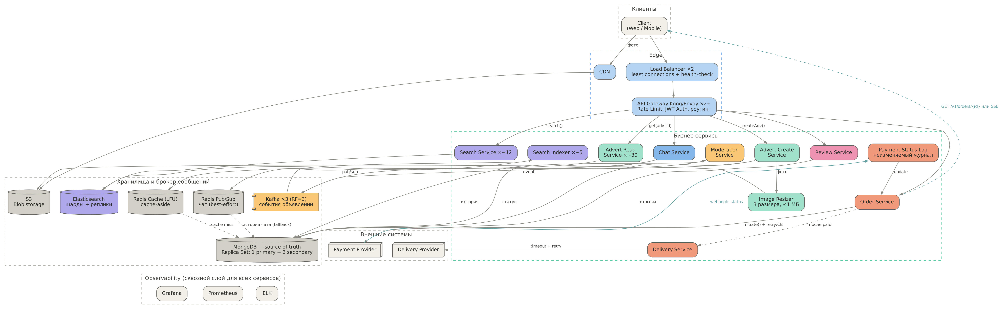

# Проектирование высоконагруженной системы

## Выбранная тема

**Сервис объявлений с доставкой** — аналог Avito + доставка.
10 млн DAU · 100 млн активных объявлений · read : write = 100 : 1 · доступность 99,9 %.

## 1. Требования

Подробно: [docs/01-requirements.md](docs/01-requirements.md)

* Функциональные — scope проекта.
* Нефункциональные — конкретные цифры.
* Риски и ограничения.
* Backlog — что не входит в scope.

## 2. Концептуальная архитектура

Подробно: [docs/02-architecture.md](docs/02-architecture.md)

* Схема C4: Context + Container — в [diagrams/](diagrams/) (PNG, SVG, Graphviz, Structurizr DSL).
* Описание компонентов (1–2 предложения на каждый).
* Обоснование архитектурного стиля.
* ADR для ключевых решений: [docs/adr/](docs/adr/).
* Пользователи и внешние интеграции.

## 3. Сайзинг

Подробно: [docs/03-sizing.md](docs/03-sizing.md)

* Расчёт RPS, хранилища, bandwidth (с формулами).
* Оценка ресурсов и стоимости.

## 4. Хранение данных

Подробно: [docs/04-data-storage.md](docs/04-data-storage.md)

* Выбор БД с обоснованием.
* Схема шардирования.
* Стратегия кэширования.
* Схемы данных.

## 5. Взаимодействие

Подробно: [docs/05-interaction.md](docs/05-interaction.md)

* Схема взаимодействия сервисов (sequence-диаграммы).
* Выбор протоколов.
* Ключевые API (5 контрактов): [api/openapi.yaml](api/openapi.yaml).

## 6. Надёжность

Подробно: [docs/06-reliability.md](docs/06-reliability.md) — RTO/RPO по сервисам, схема репликации, план DR.

## 7. Безопасность

Подробно: [docs/07-security.md](docs/07-security.md) — аутентификация и авторизация, шифрование и управление секретами.

## 8. Observability

Подробно: [docs/08-observability.md](docs/08-observability.md) — 10 ключевых метрик, 7 алертов.

## 9. Тестирование

Подробно: [docs/09-testing.md](docs/09-testing.md) — план нагрузочного тестирования, chaos-эксперименты.

## Презентация

[presentation/presentation.pptx](presentation/presentation.pptx) — 15 слайдов + 4 слайда приложения.

## Допущения

Цифры из ТЗ: DAU, число объявлений, read : write, пики RPS, p99 поиска, доступность. Остальное (15 действий в день, 0,14 записи, пик ×3, размеры ответов и фото, цены облака) — допущения; подробности и пересчёт в [docs/03-sizing.md](docs/03-sizing.md). Цены — ориентиры публичных тарифов, не коммерческое предложение.
