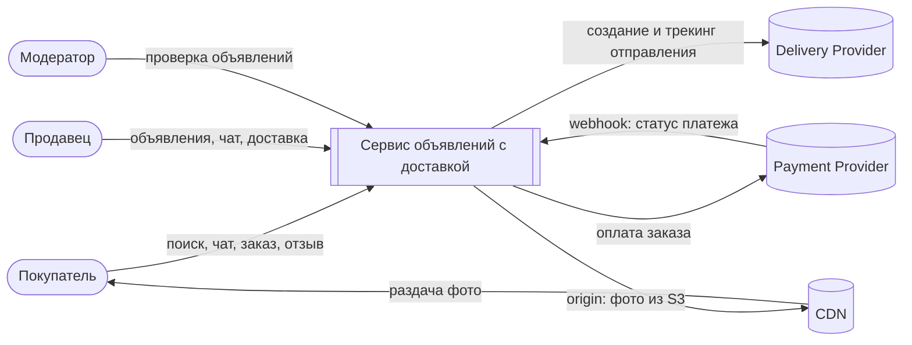

# 2. Концептуальная архитектура

Исходник диаграммы: [workspace.dsl](../diagrams/workspace.dsl) (Structurizr DSL; открывается на structurizr.com/dsl или в Structurizr Lite), картинка нарисована в Graphviz: [architecture.dot](../diagrams/architecture.dot), векторная версия: [architecture.svg](../diagrams/architecture.svg).

## 2.0 C4 Context — система и внешние акторы

Container-диаграмма (внутреннее устройство) — ниже на картинке.

## 2.1 Описание компонентов

| Компонент | Описание |
|---|---|
| **Client (Web/Mobile)** | Точка входа пользователя — покупателя, продавца или модератора; обращается ко всем сервисам только через API Gateway. |
| **CDN** | Раздаёт статические ресурсы (фото объявлений) из S3 ближе к пользователю, снижая задержку и нагрузку на бэкенд. |
| **API Gateway** | Kong или Envoy (самостоятельно развёрнутый, ≥2 реплики). Единая точка входа: балансировка нагрузки, rate limiting, JWT-аутентификация и роутинг запросов к нужному сервису. |
| **Advert Create Service** | Создаёт, обновляет и удаляет объявления (CRUD), валидирует данные, пишет в MongoDB и публикует события изменений в Kafka. |
| **Advert Read Service** | Отдаёт объявление по id для просмотра; читает через Redis-кэш с fallback в MongoDB при промахе. |
| **Image Resizer** | Приводит загруженные фото к 3 стандартным размерам и ограничению ≤1 МБ перед сохранением в S3. |
| **Search Service** | Обрабатывает поисковые запросы и фильтрацию по категории/локации/цене через Elasticsearch. |
| **Search Indexer** | Consumer Kafka-событий об объявлениях; синхронизирует поисковый индекс Elasticsearch с состоянием в MongoDB. |
| **Chat Service** | Обеспечивает обмен сообщениями между покупателем и продавцом: доставка в реальном времени через Redis pub/sub, история — в MongoDB. |
| **Review Service** | Хранит и отдаёт отзывы и рейтинги пользователей после завершения сделки. |
| **Order Service** | Оформляет заказ и инициирует оплату через внешнего Payment Provider с гарантией идемпотентности операции. |
| **Delivery Service** | Создаёт и отслеживает отправление через внешнего Delivery Provider после подтверждения оплаты. |
| **Moderation Service** | Проверяет новые и изменённые объявления (правила/ручная очередь) и обновляет их статус публикации в MongoDB. |
| **MongoDB** | Основное хранилище объявлений, чатов и отзывов — source of truth; работает как Replica Set для отказоустойчивости. |
| **Redis Cache** | Кэш чтения объявлений (cache-aside, политика вытеснения LFU, TTL, request coalescing). |
| **Redis Pub/Sub** | Отдельный инстанс: realtime-доставка сообщений чата между экземплярами Chat Service (best-effort, история — в MongoDB). Разделён с кэшем, чтобы нагрузка и сбой одного не влияли на другой. |
| **Elasticsearch** | Производный (derived) поисковый индекс, оптимизированный под полнотекстовый поиск и фильтрацию с p99 < 200 мс. |
| **S3 (Blob storage)** | Объектное хранилище фотографий объявлений в трёх размерах. |
| **Kafka** | Брокер событий, обеспечивающий асинхронную интеграцию между Advert Create Service, Search Indexer и Moderation Service. |
| **Payment Provider** | Внешняя платёжная система; вызывается из Order Service с retry и Circuit Breaker. |
| **Delivery Provider** | Внешняя служба доставки; вызывается из Delivery Service с timeout и retry. |
| **ELK / Prometheus / Grafana** | Сквозной слой observability: логи, метрики и дашборды для всех сервисов. |

## 2.2 Обоснование архитектурного стиля

Выбран **микросервисный стиль с событийно-ориентированной интеграцией** (event-driven microservices), а не монолит. Ключевые причины:

1. **Разная профиль нагрузки на операции.** Read-heavy соотношение 100:1 (5 000 RPS чтения против <50 RPS записи) требует независимого масштабирования Advert Read Service и Advert Create Service — в монолите это невозможно сделать точечно.
2. **Разные требования к консистентности.** Запись объявления должна быть строго консистентной внутри MongoDB, а поиск и просмотр — нет ("строгая консистентность не требуется"). Это естественно ложится на паттерн **CQRS**: MongoDB как write-model, Elasticsearch/Redis как read-model, синхронизируемые асинхронно через Kafka.
3. **Полиглот-персистентность.** У каждого домена свой оптимальный тип хранилища: документное (MongoDB) для объявлений, поисковый индекс (Elasticsearch) для фильтрации, in-memory (Redis) для кэша и realtime pub/sub, объектное (S3) для фото. Монолит с единой БД не позволил бы эффективно использовать специализированные движки.
4. **Изоляция отказов.** Недоступность Elasticsearch, Kafka или внешних Payment/Delivery провайдеров не должна останавливать создание объявлений или чат — в микросервисах это достигается через Circuit Breaker и очереди, в монолите деградация распространяется на весь процесс.
5. **Соответствие границам домена (DDD).** Advert, Search, Chat, Review, Order, Delivery, Moderation — независимые bounded context'ы с собственной моделью данных и жизненным циклом.

**Компромиссы, которые мы осознанно принимаем:** рост операционной сложности (больше сервисов, больше точек отказа, нужен observability-слой), eventual consistency между MongoDB и Elasticsearch (задержка индексации 1–2 сек), необходимость идемпотентности на границах (Kafka consumers, Payment, Delivery). Это приемлемо, поскольку нефункциональные требования явно допускают ослабленную консистентность и single-region деплой.

## 2.3 ADR — ключевые архитектурные решения

- [ADR-001: Микросервисы с событийной интеграцией вместо монолита](adr/ADR-001-microservices.md)
- [ADR-002: MongoDB как source of truth + Elasticsearch как derived read-model через Kafka (CQRS)](adr/ADR-002-cqrs-mongo-es-kafka.md)
- [ADR-003: Redis cache-aside (LFU) для чтения объявлений](adr/ADR-003-redis-cache-aside.md)

## 2.4 Пользователи и внешние интеграции

### Пользователи (роли)

| Роль | Сценарии использования |
|---|---|
| **Покупатель** | Поиск и просмотр объявлений, чат с продавцом, оформление заказа и оплаты, отслеживание доставки, оставление отзыва. |
| **Продавец** | Создание/редактирование/удаление объявлений с фото, чат с покупателем, обработка заказа и доставки. |
| **Модератор** | Проверка объявлений, поставленных в очередь Moderation Service, принятие решения о публикации/блокировке. |

### Внешние интеграции

| Система | Кто вызывает | Назначение | Отказоустойчивость |
|---|---|---|---|
| **Payment Provider** | Order Service | Проведение оплаты заказа | Idempotency-key, retry, Circuit Breaker |
| **Delivery Provider** | Delivery Service | Создание и отслеживание отправления | Timeout, retry, Circuit Breaker |
| **CDN** | Client (фото) | Раздача статики (фотографий объявлений) | Внешний managed-сервис, вне зоны контроля бэкенда |

Оба внешних провайдера (Payment, Delivery) находятся вне scope проекта по ограничениям — интеграция идёт через синхронный HTTP-вызов с защитными паттернами (retry/timeout/circuit breaker), описанными в таблице рисков раздела 1.

### Инфраструктура взаимодействия

| Элемент | Решение |
|---|---|
| API Gateway | Kong / Envoy: роутинг, rate limiting, JWT-аутентификация |
| Load Balancer | алгоритм least connections (запросы разной длительности) + health-check |
| Service Discovery | Kubernetes DNS/Service (допущение: оркестратор — Kubernetes); отдельный Consul не нужен при одном регионе и кластере |
| Service Mesh | не используется: синхронных межсервисных вызовов мало (основная связь через Kafka), mesh (Istio, Linkerd) добавил бы сложность без выгоды; вернёмся к вопросу при росте числа сервисов |
