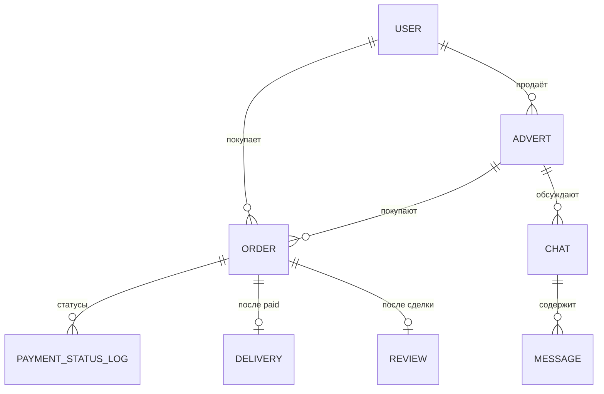

# 4. Хранение данных

## 4.1 Выбор хранилищ

| Хранилище | Что хранит | Почему |
|---|---|---|
| **MongoDB** | Объявления, чаты, отзывы — source of truth | Документная модель под объявления с разными атрибутами по категориям; шардирование и Replica Set «из коробки» |
| **Elasticsearch** | Производный поисковый индекс | Полнотекстовый поиск и фильтры с p99 < 200 мс; при потере пересобирается из MongoDB |
| **Redis (кэш)** | Горячие объявления | Cache-aside, LFU, TTL; снимает чтение с MongoDB |
| **Redis (Pub/Sub)** | Доставка сообщений чата между экземплярами | Отдельный инстанс, best-effort; история чата — в MongoDB |
| **S3** | Фото в трёх размерах | Дешёвое объектное хранилище, раздаётся через CDN |
| **Kafka** | События объявлений | Развязка записи и индексации/модерации, хранение 7 дней |
| **Payment Status Log** | Неизменяемый журнал статусов платежей | Сверка и аудит, хранение ≥ 5 лет |

## 4.2 Шардирование, репликация, партиционирование

| Тема | Решение | Обоснование |
|---|---|---|
| Шардирование MongoDB | Хешированное, ключ `hash(advert_id)` (uuidv7); перебалансировка chunk'ов в фоне при добавлении шарда | Равномерная нагрузка; чтение по id идёт на один шард. Запросы без ключа (например, «все объявления продавца») идут в Elasticsearch |
| Шардирование Elasticsearch | По категории + региону | Фильтры поиска попадают в ограниченное число шардов |
| Репликация | Master-slave: MongoDB Replica Set (1 primary + 2 secondary), запись с подтверждением большинства (2 из 3), авто-failover; Kafka RF = 3; Elasticsearch ≥ 1 реплика шарда | Master-master не берём: запись ≈ 50 RPS, конфликты multi-master не оправданы |
| Партиционирование | Горизонтальное — шарды. Вертикальное — метаданные в MongoDB, фото в S3, поисковые поля в Elasticsearch | Каждое хранилище под свой тип данных |
| Kafka | Ключ партиции `advert_id` | Порядок событий одного объявления |
| Гео-распределённые БД (CockroachDB, YugabyteDB, Spanner) | Не берём | Нужны для мультирегиона с сильной консистентностью; по ТЗ один регион, строгая консистентность не требуется |

## 4.3 Кэширование

| Вопрос | Выбор | Почему |
|---|---|---|
| Стратегия | **Cache-aside** | Запись редкая, приложение само управляет кэшем. Read-through, write-through и write-behind не берём: усложняют запись без выигрыша (write-behind ещё и рискует потерей данных) |
| Вытеснение | **LFU + TTL** | Популярные объявления остаются в кэше, разовые всплески редких не вытесняют их (LRU это допускает) |
| Redis или Memcached | **Redis** | Кроме кэша нужен pub/sub для чата, репликация, структуры данных; Memcached этого не умеет |
| Уровни | L2 — Redis, L3 — MongoDB. Локального L1-кэша в сервисе нет | Несколько экземпляров: локальные копии расходятся и устаревают по-разному; Redis достаточно для 5 000 RPS |
| CDN | Кэш на edge, S3 как origin; hit-rate > 95 % | Фото не нагружают наши сервисы |
| Cache stampede / thundering herd | Request coalescing, distributed lock на «горячих» ключах | К MongoDB при промахе идёт один запрос, остальные ждут его результата |

Расчёт объёмов хранилищ — в [03-sizing.md](03-sizing.md).

## 4.4 Схемы данных

### MongoDB — коллекции

| Коллекция | Поля (основные) | Индексы / ключ шардирования |
|---|---|---|
| `adverts` | `_id` (= advert_id, uuidv7), `sellerId`, `title`, `description`, `price` (в минимальных единицах), `currency`, `category`, `location {city, geo}`, `attributes {…}`, `photos [{size, url}]`, `status` (draft / moderation / published / blocked / deleted), `createdAt`, `updatedAt`, `deletedAt` | shard key: `hash(_id)`; индексы: `sellerId`, `status + category` |
| `chats` | `_id`, `advertId`, `buyerId`, `sellerId`, `createdAt` | индекс: `buyerId`, `sellerId` |
| `messages` | `_id`, `chatId`, `senderId`, `text`, `createdAt` | индекс: `chatId + createdAt` |
| `reviews` | `_id`, `orderId`, `authorId`, `targetUserId`, `rating`, `text`, `createdAt` | индекс: `targetUserId` |
| `orders` | `_id`, `advertId`, `buyerId`, `amount`, `currency`, `status` (created / pending / paid / failed / shipped / delivered), `idempotencyKey`, `deliveryId`, `createdAt` | уникальный индекс: `idempotencyKey`; индекс: `buyerId` |
| `payment_status_log` | `_id`, `orderId`, `providerPaymentId`, `status`, `rawPayload`, `receivedAt` | только добавление (immutable), индекс: `orderId`; хранение ≥ 5 лет |
| `deliveries` | `_id`, `orderId`, `providerShipmentId`, `status`, `trackingUrl`, `updatedAt` | индекс: `orderId` |

### Связи

### Документ поискового индекса (Elasticsearch)

`advert_id` (= `_id`), `title`, `description` (полнотекстовые поля), `category`, `price`, `location` (geo + город), `createdAt`, `status`. Индекс — производный: обновляется Search Indexer'ом upsert'ом по `_id`, при потере пересобирается из MongoDB.

### Ключи Redis

| Ключ | Значение | TTL |
|---|---|---|
| `advert:{id}` | JSON объявления | минуты (с jitter против одновременного истечения) |
| `chat:{conversationId}` (канал Pub/Sub) | сообщения чата, не хранятся | — |
