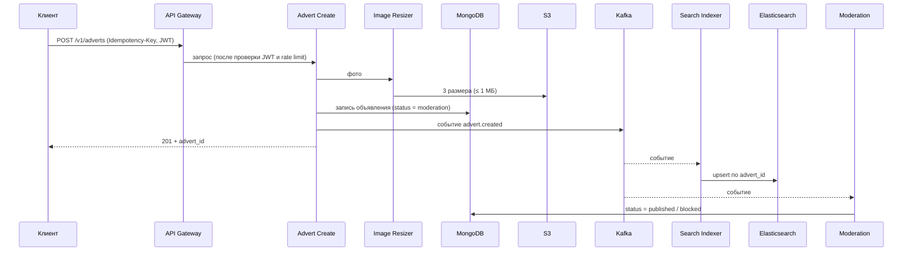
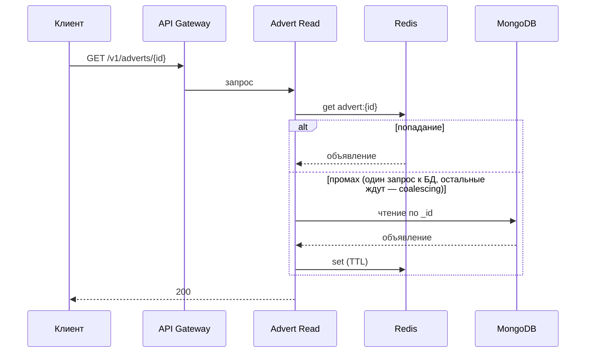
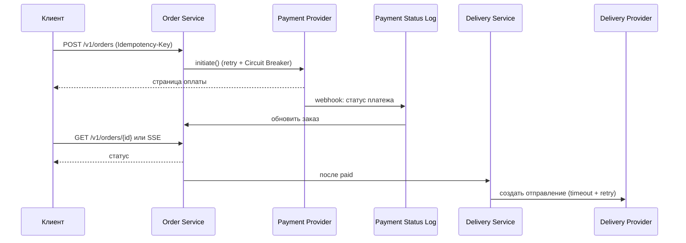
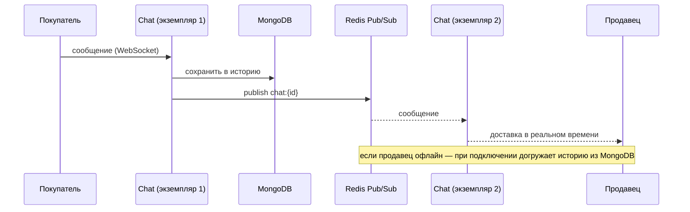

# 5. Взаимодействие

## 5.1 Протоколы и модели обмена

| Связь | Протокол | Модель | Обоснование |
|---|---|---|---|
| Client ↔ API Gateway | REST / JSON | синхронно | Публичный контракт, совместимость с web/mobile, версионирование `/v1/` |
| Gateway ↔ сервисы | REST / JSON | синхронно | Нет жёсткого latency-бюджета между сервисами, проще в эксплуатации на этом масштабе |
| Сервис → сервис (события) | Kafka | асинхронно | Развязка write/read путей, устойчивость к пикам |
| Чат между экземплярами | Redis Pub/Sub | pub/sub, best-effort | Быстрая рассылка; потеря перекрывается историей в MongoDB |

**Queue и pub/sub в Kafka.** Между *разными* группами потребителей Kafka работает как pub/sub: событие об объявлении получают и Search Indexer, и Moderation, независимо друг от друга. Внутри *одной* группы — как очередь: событие обработает только один из экземпляров.

**Что синхронно, что асинхронно.** Всё, что пользователь должен увидеть сразу (создание объявления, чтение, поиск), — синхронно. Всё, что может подождать (индексация, модерация), — асинхронно через Kafka.

## 5.2 Инфраструктура взаимодействия

| Элемент | Решение |
|---|---|
| API Gateway | Kong или Envoy (самостоятельно развёрнутый), ≥ 2 экземпляра: роутинг, rate limiting, JWT-аутентификация |
| Load Balancer | ≥ 2 экземпляра перед шлюзом; алгоритм least connections (запросы разной длительности) + health-check; внутри кластера — Kubernetes Service |
| Service Discovery | Kubernetes DNS / Service (допущение: оркестратор — Kubernetes); отдельный Consul не нужен при одном регионе и кластере |
| Service Mesh | Не используем: синхронных межсервисных вызовов мало (основная связь через Kafka); Istio/Linkerd добавили бы сложность без выгоды. Вернёмся при росте числа сервисов |

## 5.3 API-контракты

Общие правила: версионирование в пути (`/v1/`); деньги — в минимальных единицах валюты (целое число копеек); пагинация курсорная: `{items, total, nextCursor}`; ошибки — стандартные HTTP-коды с телом `{code, message}`.

### Идемпотентность

Операции, меняющие состояние и вызываемые с повторами (создание объявления, заказ), принимают заголовок `Idempotency-Key`. Сервер хранит ключ с результатом (TTL ≈ 24 ч). Повтор с тем же ключом и тем же телом возвращает прежний результат; тот же ключ с другим телом — `409`/`422`.

### Эндпоинты

| Метод и путь | Назначение | Заметки |
|---|---|---|
| `POST /v1/adverts` | Создание объявления: `createAdv()` | `Idempotency-Key` в заголовке; ответ `201` + `advert_id`; публикует событие в Kafka |
| `GET /v1/adverts/{id}` | Просмотр: `get(adv_id)` | Чтение через Redis-кэш, при промахе — MongoDB |
| `GET /v1/search?category=&location=&priceMin=&priceMax=&cursor=` | Поиск: `search()` | Elasticsearch, фильтры, курсорная пагинация, p99 < 200 мс |
| `POST /v1/orders` | Инициация заказа и оплаты | `Idempotency-Key`; Order Service вызывает Payment Provider с retry и Circuit Breaker |
| `GET /v1/orders/{id}` | Статус заказа | Либо polling, либо SSE-события |

### Как клиент узнаёт статус оплаты

1. Order Service вызывает Payment Provider (`initiate()`, retry + Circuit Breaker).
2. Provider присылает итоговый статус вебхуком; он записывается в **Payment Status Log** (неизменяемый журнал).
3. Order Service читает статус из журнала и обновляет заказ.
4. Клиент получает статус через `GET /v1/orders/{id}` или SSE.
5. После статуса `paid` Order Service запускает Delivery Service, тот создаёт отправление у Delivery Provider (timeout + retry).

## 5.4 Доставка сообщений Kafka

Гарантия **at-least-once**: событие может прийти повторно, поэтому потребители идемпотентны (Search Indexer делает upsert по `_id = advert_id`). Необработанные события уходят в DLQ, отставание контролируется метрикой consumer lag.

## 5.5 Схемы взаимодействия (sequence)

### Создание объявления

### Просмотр объявления (cache-aside)

### Заказ и оплата

### Сообщение в чате

## 5.6 Спецификация API

Полный контракт в формате OpenAPI: [api/openapi.yaml](../api/openapi.yaml).
